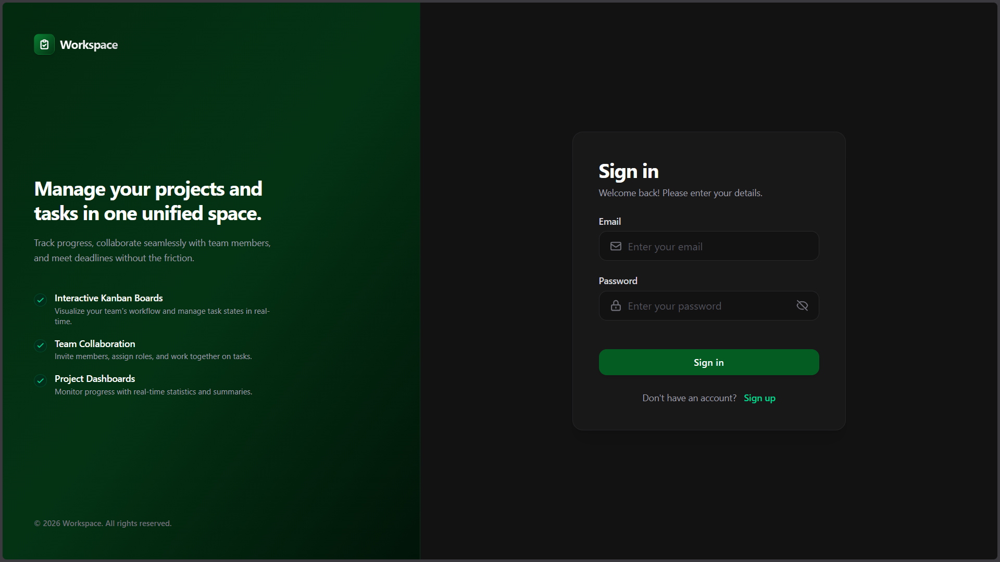
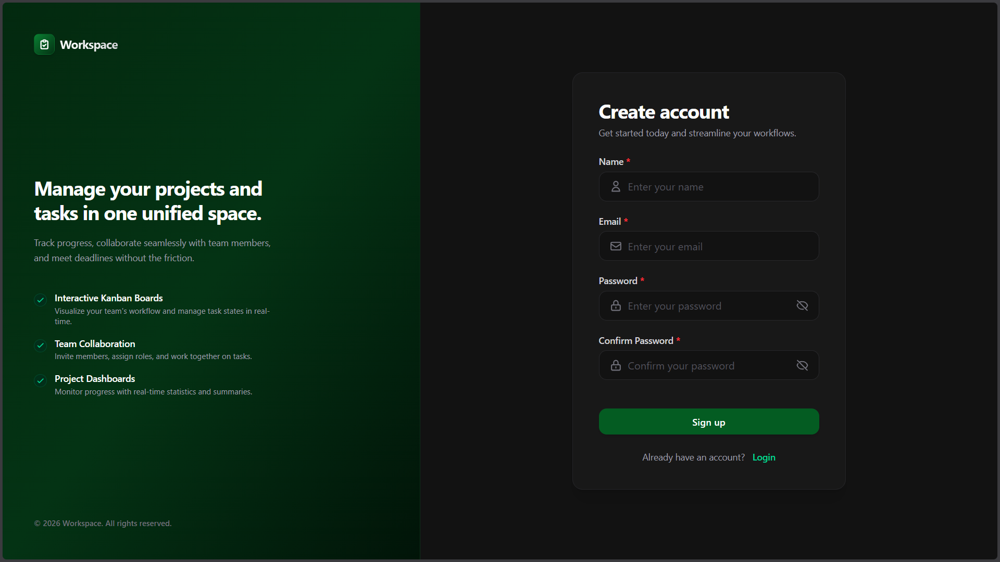
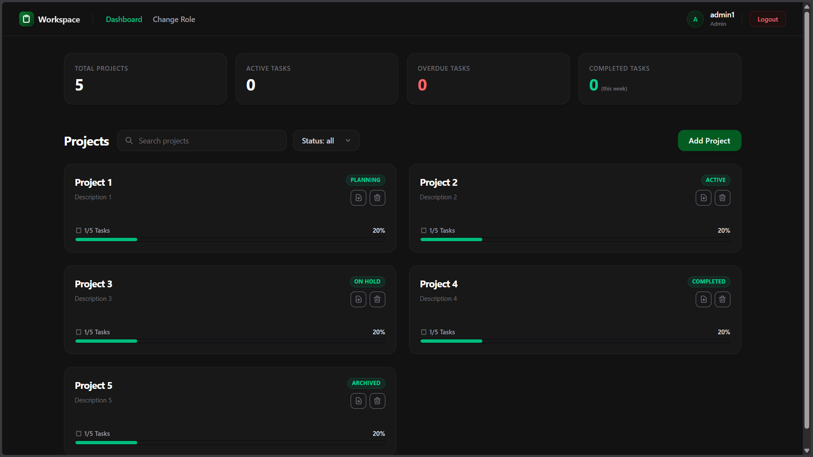
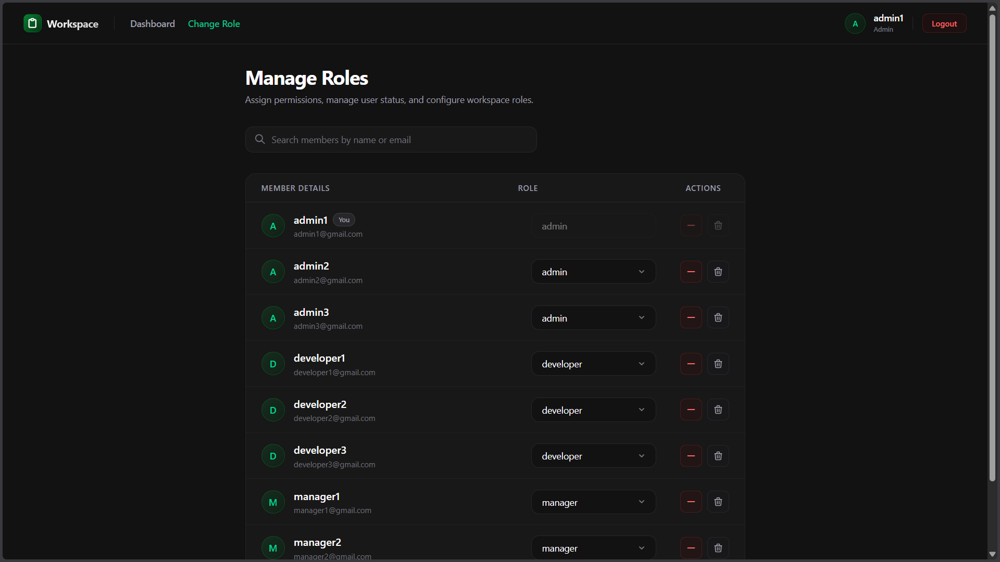
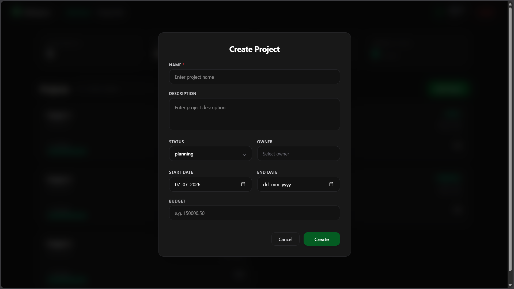
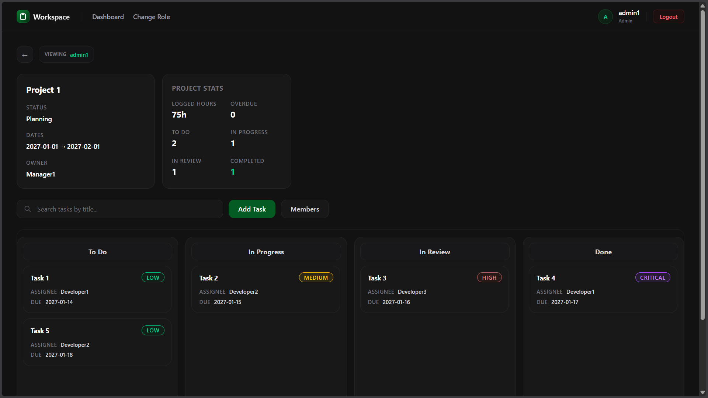
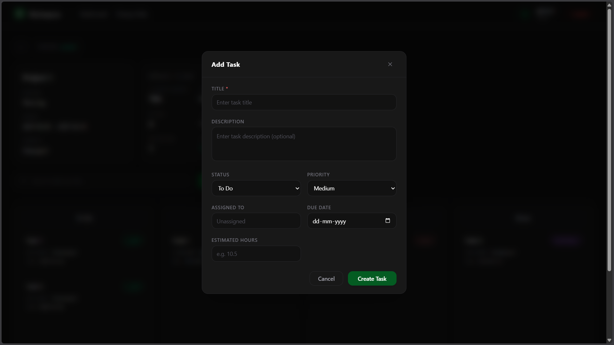
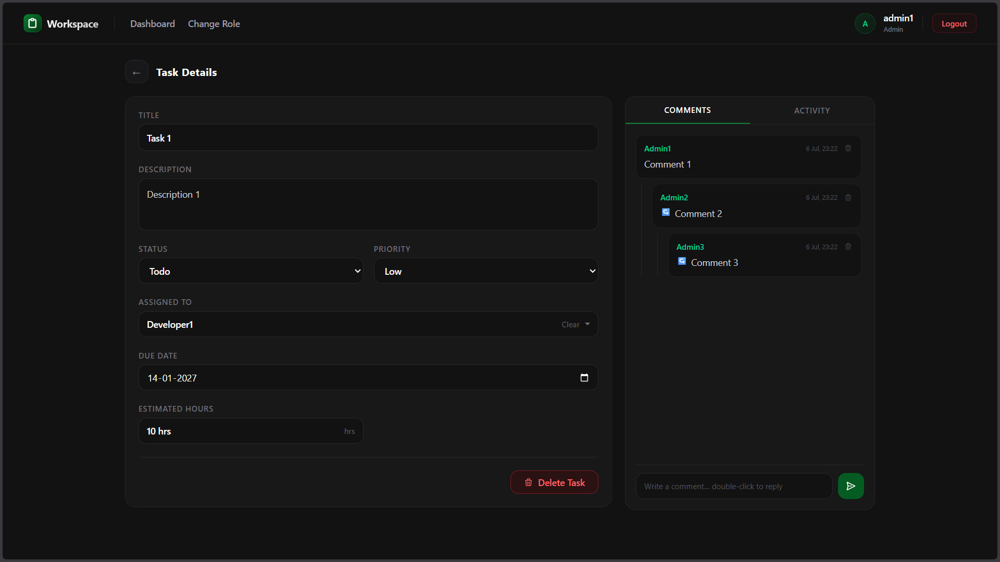

# Workspace - Smarter Project Management

A modern, full-stack enterprise project management platform designed for tracking projects, orchestrating tasks on interactive Kanban boards, collaborating with team members in real time, and querying project documents using an integrated AI Assistant powered by Retrieval-Augmented Generation (RAG).

Built with **React 19 + TypeScript** on the frontend, **Node.js + Express + Prisma** for the core business API, and **Python + FastAPI + LangChain** for the AI microservice, backed by **MariaDB 10.11**, **Redis 7**, **Qdrant Vector Database**, and **MinIO S3-Compatible Object Storage**.

---

## Screenshots

### Login


### Register


### Dashboard


### Admin — User Management


### Add Project


### Project Detail — Kanban Board


### Add Task


### Task Detail


---

## Features

### Core Project & Task Management
- 📋 **Project Lifecycle Management** — Create, update, filter, paginate, and archive projects with budget and timeline tracking.
- ✅ **Kanban Task Board** — Interactive drag-and-drop task reordering across status columns (`todo`, `in_progress`, `in_review`, `done`).
- 👥 **Team Collaboration & Rosters** — Assign tasks to team members and manage per-project user rosters.
- 💬 **Threaded Comments** — Nested comment threads on tasks for focused team discussions.
- 🕒 **Activity Timeline** — Comprehensive, chronological audit log of all project and task changes.
- 📊 **Dashboard Analytics** — Real-time tracking of active, overdue, and weekly completed tasks at a glance.
- 📤 **CSV Export** — One-click download of all project tasks and their metadata.

### AI Assistant & Document Intelligence (RAG)
- 🤖 **Task-Scoped AI Chat (`AIChatTab`)** — Interactive natural language assistant inside the task detail view that answers project questions using contextual RAG.
- 📄 **Asynchronous Document Vectorization** — Automatically ingests `.pdf`, `.docx`, `.txt`, and `.md` task attachments using **Redis Queue (RQ)** background workers for non-blocking uploads.
- 🔍 **Semantic Vector Search** — Document chunking with LangChain `RecursiveCharacterTextSplitter`, dense 384-dimensional embeddings generated with HuggingFace MiniLM, and indexed in **Qdrant** with cosine similarity.
- 🔒 **Context Isolation & RBAC** — Vector queries dynamically enforce `project_id` and `task_id` filtering to guarantee zero cross-project data leakage.
- 🧠 **High-Performance Synthesis** — Synthesizes answers using **Groq** (`openai/gpt-oss-120b`) at temperature 0 for factual, accurate responses.

### Security, Storage & Infrastructure
- 📎 **Task Attachments (MinIO S3)** — Multi-file streaming uploads (up to 10 files/50MB each) stored in S3-compatible MinIO buckets with secure, temporary pre-signed download URLs.
- 🔒 **Role-Based Access Control (RBAC)** — Granular permissions across `Admin`, `Manager`, and `Developer` roles with admin self-protection guards.
- 📧 **Email Verification & Password Reset (Brevo)** — 6-digit OTP verification upon registration and secure token-based password reset flows.
- 🔔 **Real-Time Collaboration (Socket.io)** — Instant broadcasts when tasks are created, updated, or moved, paired with **Live Presence** showing who is actively viewing the board.
- ⏱️ **Multi-Tier Rate Limiting** — Sliding-window Redis rate limiting (100 req/min for authenticated users, 20 req/min for guests, and dedicated 6 req/min for AI endpoints).
- ⚡ **HTTP ETag Caching** — Automatic ETag generation returning `304 Not Modified` on unchanged resources to minimize network bandwidth.
- ♻️ **Silent Token Refresh** — Secure JWT authentication via HTTPOnly cookies with transparent Axios interceptor refresh handling.

---

## Tech Stack

| Layer | Technology | Purpose |
|---|---|---|
| **Frontend** | React 19, TypeScript, Vite 8, TailwindCSS v4 | Modern, reactive user interface |
| **Backend API** | Node.js (ESM), Express 5, Prisma ORM 7 | Core business logic, REST API & data access |
| **AI Microservice** | Python 3.11, FastAPI, Uvicorn | RAG query pipeline and document upload API |
| **LLM & Embeddings** | Groq (`openai/gpt-oss-120b`), HuggingFace MiniLM | Natural language synthesis & dense vector embeddings |
| **Vector Database** | Qdrant | Dense vector indexing & semantic similarity search |
| **Relational Database** | MariaDB 10.11 | Primary relational data store |
| **Cache & Message Broker** | Redis 7 (ioredis) | Session storage, rate limiting, pub/sub & task queue |
| **Background Worker** | Redis Queue (RQ) | Asynchronous document processing and vectorization |
| **Object Storage** | MinIO (S3-compatible) | Task attachment storage with pre-signed URLs |
| **Real-Time Engine** | Socket.io 4 | Live updates and board presence tracking |
| **Email Service** | Brevo (Sendinblue API) | Transactional OTP verification and password reset emails |
| **Testing** | Jest, Supertest (server) / Vitest, Testing Library (client) | Automated unit and integration testing |
| **Containerization** | Docker, Docker Compose | Multi-container production & development orchestration |

---

## Docker & Performance Optimizations

The deployment configuration includes several production-grade optimizations:

- **Deduplicated AI Image (`workspace-ai:latest`):** Both `ai-server` and `ai-worker` share a single unified image tag. Docker builds the heavy AI dependencies (PyTorch, sentence-transformers, CUDA) only once, saving **~10 GB of disk space** on every build.
- **Enterprise MinIO Distribution:** Uses Chainguard's active community image (`cgr.dev/chainguard/minio:latest`) with root execution and native TCP socket health checks, avoiding Docker Hub rate-limiting and repository deprecation issues.
- **Dependency Layer Caching:** Dockerfiles copy dependency manifests (`package.json`, `requirements.txt`) prior to source code, ensuring code rebuilds execute in seconds by reusing cached layers.
- **WSL2 Dynamic Disk Reclamation (Windows):** Support for `sparseVhd=true` in `~/.wslconfig` so that virtual hard disks automatically shrink and return space to Windows when images or containers are pruned.

---

## Quick Start

### Development Mode

> Prerequisites: Docker, Node.js 20+, Python 3.11+

```bash
# 1. Start backing services (MariaDB, Redis, MinIO, Qdrant)
docker compose -f docker-compose.dev.yml up -d

# 2. Configure environment files
cp .env.example .env
cp server/.env.example server/.env
cp client/.env.example client/.env

# 3. Start Node backend (Terminal 1)
cd server
npm install
npm run prisma:migrate
npm run prisma:seed
npm run dev

# 4. Start AI Backend (Terminal 2)
cd AI
uv venv --python 3.11
.\.venv\Scripts\Activate.ps1       # On Linux/macOS: source .venv/bin/activate
uv pip install -r requirements.txt
uvicorn main:app --reload --host 0.0.0.0 --port 8000

# 5. Start AI Background Worker (Terminal 3)
cd AI
.\.venv\Scripts\Activate.ps1       # On Linux/macOS: source .venv/bin/activate
rq worker

# 6. Start React Frontend (Terminal 4)
cd client
npm install
npm run dev
```

Open [http://localhost:5173](http://localhost:5173).

---

### Production Mode (Docker Only)

> Prerequisite: Docker Desktop / Docker Engine with Compose v2

```bash
# 1. Configure production environment
cp .env.example .env   # Fill in database passwords, secrets, Brevo key, and GROQ_API_KEY

# 2. Build and launch all 8 services in detached mode
docker compose up --build -d

# 3. Seed initial demo data (optional)
docker exec pm-server-prod npm run prisma:seed
```

Open [http://localhost](http://localhost).

#### Service Port Mappings

| Service | Container Name | Port | Description |
|---|---|---|---|
| **Client** | `pm-client-prod` | `80` | React web application served via Nginx |
| **Server** | `pm-server-prod` | `5000` | Node.js Express REST API & WebSockets |
| **AI Server** | `pm-ai-server-prod` | `8000` | FastAPI RAG microservice |
| **AI Worker** | `pm-ai-worker-prod` | - | Background RQ document processor |
| **MinIO** | `pm-minio-prod` | `9000`, `9001` | S3 API (`9000`) and Web Console (`9001`) |
| **MariaDB** | `pm-mysql-prod` | `3307` | Relational database (mapped from internal `3306`) |
| **Redis** | `pm-redis-prod` | `6379` | Cache, pub/sub & message broker |
| **Qdrant** | `pm-qdrant-prod` | `6333` | Vector database HTTP API |

#### Daily Docker Management Commands

```powershell
# Stop all containers
docker compose down

# Restart the stack
docker compose up -d

# Rebuild after modifying code
docker compose up -d --build

# Clean dangling build layers
docker image prune -f
```

---

## Documentation

Comprehensive architecture, API, and deployment documentation is available in [`docs/`](docs/):

| Document | Description |
|---|---|
| [docs/deployment.md](docs/deployment.md) | Full deployment guide — environment variables, dev mode, production mode, Docker reference |
| [docs/architecture.md](docs/architecture.md) | System design — backend layers, frontend architecture, real-time events, RAG pipeline |
| [docs/database.md](docs/database.md) | Database schema — tables, columns, relations, indexes, foreign keys, and seed data |
| [docs/api.md](docs/api.md) | Complete API reference — endpoints, headers, query parameters, request/response payloads |
| [docs/features.md](docs/features.md) | In-depth feature guide — feature specifications, workflows, and permissions |
| [Postman/README.md](Postman/README.md) | Postman collection and environment setup guide |

---

## Default Seed Accounts

After running `npm run prisma:seed` (or `docker exec pm-server-prod npm run prisma:seed`), you can log in with any of the following accounts:

| Role | Email | Password |
|---|---|---|
| **Admin** | admin1@gmail.com | `AdminPass@1` |
| **Admin** | admin2@gmail.com | `AdminPass@2` |
| **Admin** | admin3@gmail.com | `AdminPass@3` |
| **Manager** | manager1@gmail.com | `ManagerPass@1` |
| **Manager** | manager2@gmail.com | `ManagerPass@2` |
| **Manager** | manager3@gmail.com | `ManagerPass@3` |
| **Developer** | developer1@gmail.com | `DeveloperPass@1` |
| **Developer** | developer2@gmail.com | `DeveloperPass@2` |
| **Developer** | developer3@gmail.com | `DeveloperPass@3` |

---

## Project Structure

```
/
├── client/                  # React 19 + TypeScript frontend (Vite & TailwindCSS)
│   ├── src/
│   │   ├── components/      # Reusable UI components & modals
│   │   ├── pages/           # Route views (Dashboard, Project Detail, Login, Admin)
│   │   ├── services/        # API client, Socket.io client, and HTTP interceptors
│   │   └── context/         # Auth, Project, and Toast providers
│   └── nginx.conf           # Production Nginx reverse proxy configuration
├── server/                  # Node.js + Express backend (ESM & TypeScript)
│   ├── src/
│   │   ├── controllers/     # Route handlers & business logic
│   │   ├── middlewares/     # Auth, policy (RBAC), rate limiter, ETag, Multer
│   │   ├── routes/          # API route definitions
│   │   ├── services/        # Email (Brevo), MinIO S3, Socket.io services
│   │   └── socket/          # Real-time event handlers & live presence tracking
│   └── prisma/              # Prisma schema, migrations, and seed scripts
├── AI/                      # Python FastAPI AI microservice
│   ├── dependencies/        # Qdrant client, HuggingFace embeddings, Groq LLM, rate limiter
│   ├── routers/             # RAG upload and query endpoints
│   ├── services/            # Document parsing, LangChain chunking & vector search
│   ├── worker.py            # RQ background worker entrypoint
│   └── main.py              # FastAPI application entrypoint
├── docs/                    # Architecture, API, database, and deployment specifications
│   └── screenshots/         # Application UI screenshots
├── Postman/                 # Exported Postman collection and environment files
├── UI/                      # Excalidraw wireframes and design assets
├── docker-compose.yml       # Production multi-container stack (8 services)
├── docker-compose.dev.yml   # Development backing services (MariaDB, Redis, MinIO, Qdrant)
└── script.sql               # Raw SQL schema reference
```

---

## Running Tests

```bash
# Backend Unit & Integration Tests (Jest + Supertest)
cd server && npm run test

# Frontend Unit Tests (Vitest + React Testing Library)
cd client && npm run test        # Watch mode
cd client && npm run test:run    # Single run
```
